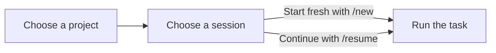
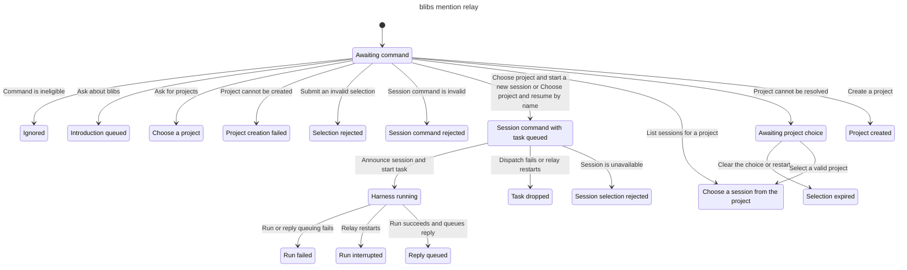

# Mention relay statechart

## Provider workflow

Muse can skip discovery when it already knows the project and session.
Include the full task in the session command.

## Request lifecycle

The generated chart follows one command in one chat and project. A project
or session list ends that command. Muse sends a separate command to start
the task. The chart omits transitions that leave the request phase unchanged.

