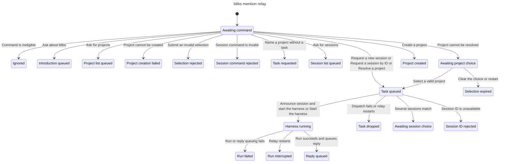

# Mention relay statechart

The chart shows one request in one chat and project. It starts with either
an empty session list or two saved sessions. It omits steps that leave the
request phase unchanged, such as toggling the harness or changing the
project list while a task waits.

